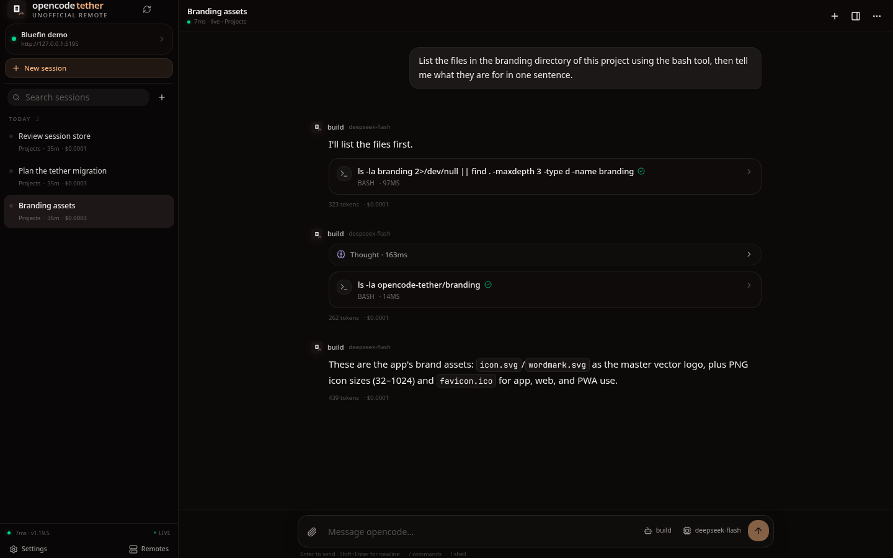

# opencode-tether

[](https://github.com/dixonSolutions/opencode-tether/actions/workflows/ci.yml)
[](https://github.com/dixonSolutions/opencode-tether/actions/workflows/release.yml)
[](LICENSE)
[](#install)

**A native-feeling remote interface for [opencode](https://opencode.ai). Unofficial, independent, and a hobby project.**

opencode keeps its own web app. opencode-tether is a separate, mobile-first client for it: SvelteKit + shadcn-svelte in the browser, Tauri on Android and the desktop, and an optional Rust host that serves the app and proxies the opencode API behind one login.



> **Not affiliated with or endorsed by the opencode project.** The opencode mark is used only to identify the service this app connects to. opencode-tether is not a fork of opencode and does not replace it.

## Why tether?

opencode already has an excellent local web UI. opencode-tether is for the case where you want to use it **away from the machine**: on a phone, a tablet, a couch, or through a tailnet. It keeps the parts that matter on a small screen — sessions, streaming output, tool calls, permissions, questions, models, agents, todos, diffs, and a terminal — and gives you one place to manage the hosts you connect to.

The recommended topology is:

```
┌───────────────────────────────┐        ┌──────────────────────────────┐
│ opencode-tether app           │  HTTPS │ opencode-tether host (Rust)  │
│ web / Android / Flatpak       │ ─────► │  • serves the SvelteKit UI   │
│ remotes, sessions, chat, PTY  │  SSE   │  • proxies the opencode API  │
└───────────────────────────────┘  WS    │  • one username + password   │
                                       │  • launches opencode serve    │
                                       └──────────────┬───────────────┘
                                                      │ loopback
                                               ┌──────▼──────┐
                                               │  opencode   │
                                               │  serve      │
                                               └─────────────┘
```

You can also point the app directly at an existing `opencode serve` instance. No host shim is required for that mode.

## What works

- **Session-first chat** with streaming text, reasoning, tool calls, diffs, and step metadata.
- **Permissions and questions** as inline cards with allow/always/deny and multi-select answers.
- **Models and agents** from the connected opencode host, with favorites and per-session selection.
- **Commands and shell** in the composer: `/command` and `!command`.
- **Attachments**: images and files are sent as opencode file parts.
- **Session management**: create, rename, delete, fork, summarize, share, copy a deep link.
- **Todos and changed files** in a side panel with expandable patches.
- **Terminal** over opencode's PTY WebSocket, with resize and mobile keyboard support.
- **Central remote manager**: named hosts, username/password or bearer key, default host, last-used host, per-host health, latency, opencode version, and busy sessions.
- **Host mode**: when the Rust host serves the app, it knows it is the host, hides remote switching, and only asks for the host login.
- **Native storage** for host credentials and settings on Android/desktop; browser local storage on the web.
- **Updates**: Android APK downloads are manual; Flatpak updates go through the Flatpak remote; host updates use `opencode-tether update`; desktop packages are downloaded from releases.
- **Responsive**: 320 px phones, 390 px phones, tablets, landscape phones, and wide desktops. Safe-area insets for Android system bars.

Some opencode web features are still being bridged (for example MCP account flows, the full file tree, and every LSP surface). The core remote loop is complete and tested.

## Install

### Host (recommended for remote access)

The host is a single static Rust binary plus the embedded web app. It runs as your user so opencode can work on your projects.

**Debian / Ubuntu**

```sh
sudo install -d -m 0755 /etc/apt/keyrings
curl -fsSL https://dixonSolutions.github.io/opencode-tether/repo/key.asc \
  | sudo gpg --dearmor -o /etc/apt/keyrings/opencode-tether.gpg   # when the repo is signed
echo "deb [signed-by=/etc/apt/keyrings/opencode-tether.gpg] https://dixonSolutions.github.io/opencode-tether/repo/apt stable main" \
  | sudo tee /etc/apt/sources.list.d/opencode-tether.list
sudo apt update && sudo apt install opencode-tether
```

If the repository is currently unsigned, use `[trusted=yes]` instead of `signed-by=...`, or install the `.deb` from [Releases](https://github.com/dixonSolutions/opencode-tether/releases).

**Fedora / RHEL / CentOS Stream**

```sh
sudo curl -fsSL https://dixonSolutions.github.io/opencode-tether/repo/rpm/opencode-tether.repo \
  -o /etc/yum.repos.d/opencode-tether.repo
sudo dnf install opencode-tether
```

**Any Linux**

Download the static binary for your architecture from Releases and put it on `PATH`:

```sh
sudo install -m 0755 opencode-tether-x86_64-unknown-linux-musl /usr/local/bin/opencode-tether
```

Then:

```sh
opencode-tether init          # asks for a host username and password
opencode-tether serve         # starts on http://0.0.0.0:4096
```

Install it as a user service:

```sh
opencode-tether service install --user
systemctl --user daemon-reload
systemctl --user enable --now opencode-tether
loginctl enable-linger "$USER"
```

Or copy the config to the default location and use the packaged unit:

```sh
opencode-tether init --config ~/.config/opencode-tether/config.toml
systemctl --user enable --now opencode-tether
```

Read [docs/host.md](docs/host.md) before exposing it beyond localhost. Put it behind HTTPS (Caddy, Tailscale Serve, nginx) if it is not on a trusted network.

### Web

Open the host address in a browser. The host serves the app itself; there is nothing else to install. The app is also a PWA (`manifest.webmanifest`) and can be added to a home screen.

### Flatpak (Linux desktop app)

```sh
flatpak remote-add --if-not-exists --user --no-gpg-verify tether \
  https://dixonSolutions.github.io/opencode-tether/repo/flatpak
flatpak install --user tether ai.opencode.tether
```

Remove `--no-gpg-verify` when the repository is published with a signing key, and import the key first:

```sh
curl -fsSL https://dixonSolutions.github.io/opencode-tether/repo/key.asc \
  -o /tmp/opencode-tether.asc
flatpak remote-add --if-not-exists --user --gpg-import=/tmp/opencode-tether.asc tether \
  https://dixonSolutions.github.io/opencode-tether/repo/flatpak
```

Updates are managed by Flatpak:

```sh
flatpak update ai.opencode.tether
```

The app also offers a **Settings → Updates** panel that opens the right place and copies the command. See [docs/install.md](docs/install.md).

### Android

Download the APK from [Releases](https://github.com/dixonSolutions/opencode-tether/releases) and install it. Android side-loading means **updates are manual**: download the new APK and install it over the app. Settings, saved hosts, and credentials are kept.

### Desktop from releases

The Flatpak is the supported Linux desktop delivery. A standalone desktop binary is attached to each release for advanced users; install the newer package over the old one to update.

## Using it

1. **Host mode** (served by the Rust host): open the host URL, sign in with the host username/password, and you are done. Remote switching is intentionally disabled.
2. **Remote mode** (browser/PWA/native app): add a host in the first-run screen or the Remotes panel. Save a name, URL, and either a username/password or an API key. The last used host opens automatically next launch; the starred host is the default.
3. Pick a session or send a message. A new session is created if none is selected.
4. Use `/` for commands, `!` for a shell command, the paperclip for attachments, and the session menu for Terminal, Share, Fork, Summarize, Rename, and Delete.

### Health indicators

The dot on each host is:

- green — reachable and idle
- pulsing amber — reachable and working (one or more busy sessions)
- blue — checking
- yellow — reachable but authentication failed
- red/grey — unreachable or offline

## CLI

```text
opencode-tether init [--username USER] [--password PASS] [--bind ADDR] [--upstream-port N]
                     [--command CMD] [--config FILE] [--force] [--non-interactive]
opencode-tether serve [--config FILE]
opencode-tether status [--config FILE] [--json]
opencode-tether doctor [--config FILE]
opencode-tether update [--check] [--force]
opencode-tether config path|show
opencode-tether service install [--user|--system] [--force]
opencode-tether service uninstall [--user|--system]
opencode-tether version
```

`init` writes a config with an Argon2 password hash and a random cookie secret. `serve` launches the configured opencode command, waits for its health endpoint, then serves the app and proxies the API. `update` downloads a newer host release, verifies its SHA-256, and replaces the binary atomically.

### Command variables

The `opencode.command` string can use:

- `{port}` — the configured upstream port
- `{hostname}` — the configured upstream hostname
- `{bind}` — the public listen address
- `{url}` — the upstream base URL

The default is:

```toml
command = "opencode serve --hostname 127.0.0.1 --port {port}"
```

If you already run opencode elsewhere, set `autostart = false` and point `hostname`/`port` at it. If that upstream uses HTTP auth, set `opencode.username` and `opencode.password`; the host injects Basic auth upstream and never exposes those credentials to the browser.

## Configuration

The full example is in [packaging/config.example.toml](packaging/config.example.toml). The important parts:

```toml
[server]
bind = "0.0.0.0:4096"
username = "opencode"
password_hash = "$argon2id$..."   # generated by init
cookie_secret = "..."             # generated by init
secure_cookies = false
# public_url = "https://tether.example.com"
session_days = 30

[opencode]
command = "opencode serve --hostname 127.0.0.1 --port {port}"
port = 5191
hostname = "127.0.0.1"
autostart = true
startup_timeout_secs = 40
health_interval_secs = 10

[web]
title = "opencode-tether"
# root = "/usr/share/opencode-tether/web"   # optional disk override for development

[update]
repo = "dixonSolutions/opencode-tether"
channel = "stable"
```

## Security

Read [SECURITY.md](SECURITY.md). The short version:

- The host listens on all interfaces by default so it is useful on a LAN/tailnet; use a firewall and HTTPS.
- Host credentials are Argon2-hashed; sessions are signed HttpOnly cookies plus optional HTTP Basic. Login attempts are rate-limited. Cross-origin writes with cookie auth are rejected.
- Saved remote credentials are stored in plain JSON in the browser's local storage or the native app's data directory. Treat the device as trusted. Prefer a bearer key or a host-specific password over a reused password.
- The host strips its own auth before forwarding to opencode and can inject a separate upstream Basic auth.
- There is no telemetry in opencode-tether.

## Development

```sh
git clone https://github.com/dixonSolutions/opencode-tether
cd opencode-tether

# web
npm --prefix apps/tether install
npm --prefix apps/tether run dev          # http://127.0.0.1:5173
npm --prefix apps/tether run check
npm --prefix apps/tether run build

# server (embeds apps/tether/build)
cargo test --manifest-path server/Cargo.toml
cargo run --manifest-path server/Cargo.toml -- init --config /tmp/tether.toml --password test
cargo run --manifest-path server/Cargo.toml -- serve --config /tmp/tether.toml

# desktop
npm --prefix apps/tether run tauri dev
npm --prefix apps/tether run tauri build

# android
npx --prefix apps/tether tauri android init
npx --prefix apps/tether tauri android build --apk
```

The web build must exist before the server is compiled because the UI is embedded into the Rust binary. `server/build.rs` writes a placeholder if it is missing and prints a warning.

### Repository layout

```
apps/tether/                 SvelteKit + shadcn-svelte app
  src/lib/api/               opencode client, SSE stream, health
  src/lib/state/             settings and application state
  src/lib/components/tether/ product UI
  src-tauri/                 Tauri v2 shell, desktop + Android
server/                      Rust host, proxy, auth, CLI, updater
packaging/                   deb/rpm, Flatpak, systemd, config example
scripts/                     repo and release helpers
docs/                        host, install, architecture, testing, branding
```

See [docs/architecture.md](docs/architecture.md) for the request flow and [docs/testing.md](docs/testing.md) for the test matrix.

## Testing

The UI was exercised against a live opencode 1.19.5 server on an Android 13 VM (portrait and landscape, release APK), in Chromium at 1440×900, 820×1180, 390×844, 320×640, and 844×390, and as a Tauri desktop app under Xvfb. The host shim was tested for login, cookie and Basic auth, CSRF rejection, SSE, WebSocket PTY proxying, static embedding, traversal rejection, upstream auth injection, child process startup/shutdown, deb/rpm installation, and APT/DNF repository generation.

Screenshots live in [docs/screenshots](docs/screenshots). Details and commands are in [docs/testing.md](docs/testing.md).

## Releases

Every push to `main` builds a pre-release (`v0.1.0-main.N`). Pushing a `v*` tag builds a stable release. Assets include host binaries for x86_64/aarch64/armv7, `.deb` and `.rpm` packages, an Android APK, a Flatpak bundle, and `SHA256SUMS`. Package repositories and the Flatpak remote are published to GitHub Pages.

See [docs/releases.md](docs/releases.md).

## Branding

opencode-tether uses the opencode box mark, plus a small tether link, to identify the service it connects to. It is not the official opencode icon and does not imply endorsement. The name, wordmark, and app icons are part of this independent project. Details: [docs/branding.md](docs/branding.md).

## License

MIT. See [LICENSE](LICENSE). opencode, SvelteKit, shadcn-svelte, Tauri, and the bundled fonts keep their own licenses; see [THIRD_PARTY.md](THIRD_PARTY.md).

## Acknowledgements

- [opencode](https://opencode.ai) for the server, API, and the mark this project points at.
- [SvelteKit](https://svelte.dev), [shadcn-svelte](https://shadcn-svelte.com), [bits-ui](https://bits-ui.com), and [Tailwind CSS](https://tailwindcss.com).
- [Tauri](https://tauri.app) and WebKitGTK.
- [xterm.js](https://xtermjs.org) for the terminal.
- The opencode community for testing feedback and patience.
